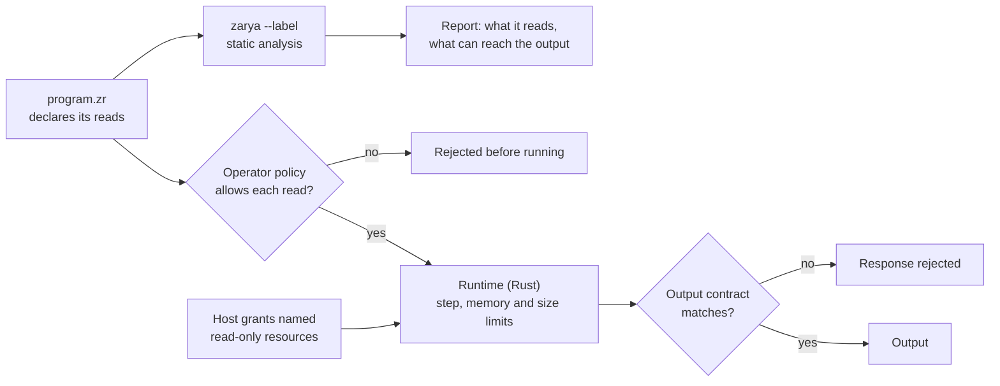

<div align="center">


# Zarya

**A small language for safer website logic.**<br>
Programs declare what they may read, and a static label shows what they can output, before they run.

[](https://github.com/zakidemo/zarya/actions/workflows/ci.yml)
[](#license)


**English** · [العربية](README.ar.md)

</div>

> [!WARNING]
> Zarya is an experimental research prototype (0.0.18-dev.14). It has not had an independent security audit and is not meant for production.

## Why Zarya?

Most web security bugs repeat the same few mistakes: SQL built from user input, requests nobody validated, and code that can read any file on the server. More and more of that code is written by AI and never reviewed.

In Zarya those mistakes cannot be written.

| | |
|---|---|
| 🔒 **Declared reads only** | A program lists every resource it may read: `permission text courses;`. Nothing else is reachable. |
| 🚫 **No dangerous operations** | The language has no SQL, files, network or writes. The host runs fixed, read-only queries. |
| 📐 **Strict contracts** | Schemas reject unexpected fields and wrong types. Output contracts reject any response that holds undeclared data. |
| 🏷️ **The label** | `zarya --label` tells you, without running the program, what it reads and which fields can reach its output. In English or Arabic. |
| 🦀 **Memory-safe runtime** | Written in Rust with `#![forbid(unsafe_code)]` and zero dependencies. |

## See it

**Four classic attacks, against a naive PHP search and against Zarya:**


**The label catches a hidden read before the program runs:**


## A program

```text
// Courses priced at 4000 or less: only id and title leave the program.
permission text courses;
schema Course { id: Int; title: Text; price_minor: Int; }
let rows: List<Json> = json_records(json_parse(read_text("courses")), "Course");
let cheap: List<Json> = filter(rows, c, json_as_int(json_get(c, "price_minor")) <= 4000);
print(json_list(map(cheap, c => json_object("id", json_get(c, "id"), "title", json_get(c, "title")))));
```

Its label, produced without running it:

```text
$ zarya --label cheap_courses.zr
Zarya label (static analysis; the program was not run)
Reads: courses
Effects: reads the resources above and prints; the language has no write, file, network or SQL operation
Data that can appear in the output:
  courses: fields id, title
Data used in conditions:
  courses: fields price_minor; whether it is valid
Output objects: other printed values
Findings: none
```

`price_minor` is used to filter, but it never reaches the output, and the label says so.

## How it works



## Quick start

Requires [Rust](https://www.rust-lang.org/tools/install). No network access is needed to build.

```bash
cd runtime/rust
cargo build --release --offline
cargo test --release --offline        # 241 tests

./target/release/zarya ../examples/cheap_courses.zr --grant-text courses=../examples/courses.json
./target/release/zarya --label ../examples/cheap_courses.zr
./target/release/zarya --label-ar ../examples/cheap_courses.zr   # Arabic label
./target/release/zarya --label-json ../examples/cheap_courses.zr # for tools
```

On Windows the executable is `target\release\zarya.exe`.

## Run the attack demo

Requires Python 3, Rust, and PHP with SQLite3. If your PHP has no `php.ini`, the demo enables SQLite3 for its own run only.

```bash
python -I -X utf8 run_demo.py
```

Expected last line: `PASS: all attacks leaked data from naive PHP and none leaked from Zarya.`

| Attack | Naive PHP | Zarya |
|---|---|---|
| SQL injection in the search box | ❌ staff emails and password hashes leak | ✅ treated as plain text |
| Text sent where a number is expected | ❌ unpublished course leaks | ✅ request rejected |
| A private column returned by mistake | ❌ cost column leaks | ✅ output contract rejects it |
| Code reads a secret file (two variants) | ❌ file is read | ✅ permission denied |

The PHP script is written badly on purpose. Careful PHP (prepared statements, validation) also stops the first three attacks. The point is that in Zarya the unsafe version cannot be written. All data is synthetic and local.

## Checking the label

The label is designed to over-report and never under-report. `label_check/marker_check.py` runs 29 tricky programs on data where every value carries a marker, and checks that every value reaching the output is covered by the label.

```bash
python -I -X utf8 label_check/marker_check.py runtime/rust/target/release/zarya
```

Expected: `29 programs ran, 0 problems`.

## Language at a glance

| | |
|---|---|
| Types | `Int` (checked 64-bit), `Text`, `Bool`, `Json`, `List<T>` |
| Declarations | `permission text <name>;` · `schema Name { field: Type; }` · `let x: T = …;` · `fn f(a: T): T = …;` |
| Control flow | `if … { } else { }` · `for x in list { }` · `assert(…);` · no recursion |
| Lists | `filter(list, x, condition)` · `map(list, x => …)` · `len` · `at` · `append` · `sum` |
| JSON | `json_parse` · `json_get` · `json_as_int/text/bool` · `json_records` · `json_validate` · `json_object` · `json_list` · … |
| Effects | `read_text("<declared name>")` and `print(…)`. Nothing else. |

## Limits

- The label is **tested** (14 unit tests, 29 marker programs), **not formally proved**. It covers values and conditions, not timing or the fact that a program stopped with an error.
- The language only reads and prints. There is no write, session or upload support yet.
- Everything runs locally. Remote hosting, sandboxing and an independent review are not part of this release.
- A memory-safe runtime does not protect a server whose PHP engine is vulnerable. Zarya here runs as a separate process, not as a replacement for PHP.

## Repository layout

```text
runtime/rust/      the Zarya runtime and the label (Rust, no dependencies)
runtime/examples/  example programs and data
zarya_app/         the demo's Zarya programs, policy and contracts
php_naive/         the intentionally vulnerable PHP used for comparison
run_demo.py        the attack demo
label_check/       the marker-based check of the label
```

## Contributing and security

Feedback, issues and attempts to break Zarya are welcome. See [CONTRIBUTING.md](CONTRIBUTING.md). To report a vulnerability privately, see [SECURITY.md](SECURITY.md).

## Citing

If you use Zarya in research, please cite it. GitHub's **Cite this repository** button reads [CITATION.cff](CITATION.cff).

## License

Copyright (c) 2026 NEILI Zakaria. Licensed under either of [Apache License, Version 2.0](LICENSE-APACHE) or [MIT license](LICENSE-MIT), at your option.

<div align="center">
<sub>Made at <a href="https://arabaiacademy.com">ArabAI Academy</a></sub>
</div>
